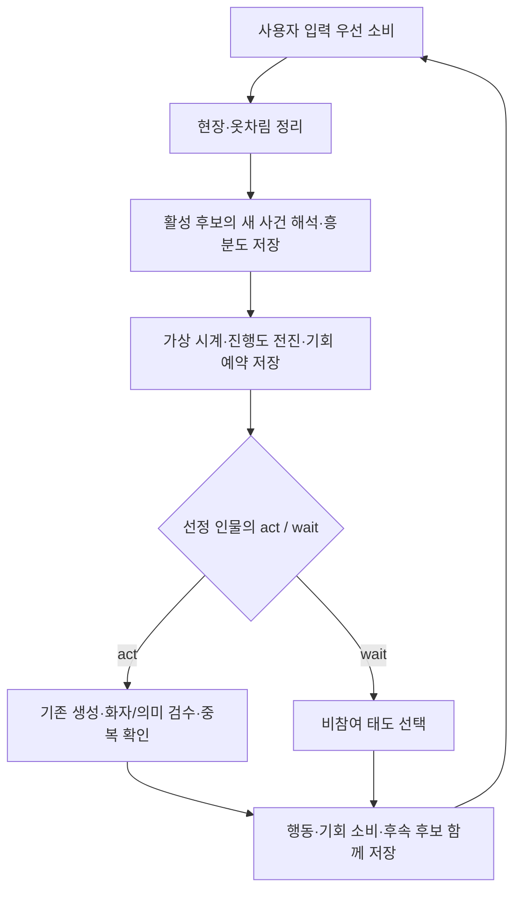

# 반응 속도에 따른 행동 판단 기회

상태: **구현됨**. 갱신일: 2026-10-25 KST. 기준: 기존 `e10c316`의 FIFO 반응 루프에 속도·흥분도·예약 복구를 연결했다. 실제 계약은 [타입](../src/lib/theater/types.ts), [스케줄러](../src/lib/theater/reaction-scheduler.ts), [실행기](../src/lib/theater/ensemble.ts), [검증기](../src/lib/theater/validation.ts)가 기준이다. 이 문서는 구현자와 세계관 작성자를 위한 현재 동작 설명이며 수식·저장·편집 정책이 바뀌면 함께 갱신한다.

## 행동 판단 기회와 속도

인물마다 행동 진행도를 쌓고 100에 도달하면 기존 `act / wait` 판단 기회를 얻는다. 기회는 발언·문장 수를 강제하지 않는다. 계속 활성인 두 인물의 최종 속도가 20과 5로 유지되면 같은 가상 시간 구간에서 기회 빈도는 4:1이다. 유한 구간의 끝·동률에서는 한 기회 정도의 차이가 날 수 있다. 한 인물이 기다리거나 씬을 떠나면 그동안 기회를 발생시키지 않는다.

| 설정 | 범위 | 기본값 | 편집 위치 |
| --- | --- | --- | --- |
| 원형 `reactionProfile.baseSpeed` | 1~100 정수 | 10 | 캐릭터·사물 → 기본 반응 속도 |
| 원형 `reactionProfile.talkativeness` | 0~100 정수 | 50 | 캐릭터·사물 → 말수 성향 |
| 인스턴스·초기 배치 `arousal` | 0~100 정수 | 0 | 배치·관계 → 현재/시작 시 흥분도 |

```text
성향 배율 = 0.5 + talkativeness / 100
흥분 배율 = 1 + arousal / 100
최종 속도 = clamp(baseSpeed × 성향 배율 × 흥분 배율, 1, 300)
```

기본 설정이면 최종 속도는 10이다. 말수 50인 기본 속도 10의 인물이 흥분도 100이 되면 최종 속도는 20이다. 이 수식은 구현의 초기 계수이며 실제 대화 품질로 보정할 수 있다. 성격 원문을 매번 수치로 재분류하지 않고 작성한 성향을 사용한다. 피로·행동 종류별 비용·흥분도 자동 감쇠는 추가하지 않았다.

## 다음 기회를 선정하는 계산

각 활성 후보의 남은 시간을 `(100 - 진행도) / 최종 속도`로 계산하고 최솟값만큼 가상 시계를 전진한다. 같은 구간에서 모든 활성 후보의 진행도에 `각자의 속도 × 경과량`을 더한다. 준비된 한 인물의 기회를 예약하고, 실제 결과 확정 시 100을 소비한다. 실제 타이머나 주기적 게이지 업데이트는 사용하지 않는다.

속도 20인 A는 가상 시점 5·10·15·20에, 속도 5인 B는 시점 20에 기회를 얻는다. 시점 20의 두 기회를 모두 처리한 뒤 다음 시점으로 넘어간다. 동률은 지정 상대, 마지막 기회 순번이 오래된 인물, 저장된 후보 배열 순서로 결정한다. 지정 상대도 준비되지 않았다면 먼저 행동하지 않는다.

가상 시계는 `WorldState.tick/day/minute`와 별개이며 HTTP 대기 시간도 반영하지 않는다. NPC의 여러 발언이 게임 시간을 자동으로 흐르게 하지 않는다. 사용자 입력은 기존대로 먼저 반영하고 NPC 속도 경쟁에 넣지 않는다.

### 진행도 보존과 종료

- 새 발언·행동을 목격한 기존 후보의 진행도를 초기화하지 않는다. 빠른 인물의 연속 발언으로 느린 인물의 기회가 계속 뒤로 밀리지 않는다.
- 속도가 변해도 이미 쌓인 진행도는 유지한다. 진행도 50에서 속도가 5→20이면 남은 시간은 10→2.5로 줄어든다.
- 행동을 확정하고 현재 씬에 남은 인물은 진행도 0부터 다시 참여할 수 있다.
- `watch / continue / idle`과 완전 중복 결과는 한 기회를 소비하고 새 사건까지 후보에서 빠진다. 기다림과 개인 해석 갱신만으로 다른 인물을 깨우지 않는다.
- 잠든 인물과 무대 밖 인물은 진행도를 쌓지 않는다. 재활성화 시 보존된 진행도를 이어받고 비활성 기간을 소급 계산하지 않는다.
- 후보·미처리 사용자 입력·미확정 예약이 모두 없으면 작업을 완료한다. 라운드 수나 발언 횟수로 끝내지 않는다.

## 새 사건과 흥분도

기존 `character_reflection` 응답에 필수 nullable 필드 `arousalUpdate`를 추가했다.

```json
{
  "relationshipUpdates": [],
  "memoUpdate": null,
  "arousalUpdate": {
    "value": 65,
    "evidenceEventIds": ["새로-목격한-사건-ID"]
  }
}
```

`value`는 변경 후 절대값이다. 변화가 없으면 `arousalUpdate: null`이다. 근거는 제공된 목격 사건이어야 하며 새 사건을 적어도 하나 포함해야 한다. 관계 변경이 없어도 흥분도만 바꿀 수 있다. 모든 제안을 검증한 뒤 관계·메모·흥분도와 기존 `reflectedThroughEventId`를 함께 저장하여 같은 사건을 중복 적용하지 않는다. 자기 행동과 단순 wait는 기존처럼 새 해석에서 제외한다.

다음 기회를 예약하기 전에 모든 활성 후보의 미처리 해석을 4개씩 처리한다. 느린 인물도 새 사건으로 흥분하면 바로 다음 속도 계산에 반영된다. 해석 자체는 가상 시계를 전진하거나 기회를 소비하지 않는다. 예약 후 서버가 재개되면 이미 확정한 해석을 반복하지 않고 그 예약에서 이어간다.

흥분도 전용 모델 호출을 따로 추가하지는 않았다. 다만 느린 인물의 해석을 먼저 수행하므로 첫 답변이 늦어질 수 있고, 빠른 인물의 발언마다 다른 인물도 해석할 수 있다. **기회 빈도 4:1이 전체 모델 호출 비용 4:1을 의미하지 않는다.** 자기 흥분도와 성향은 자기 모델 입력에만 추가하며 타인의 `present`나 삽화용 공개 맥락에 넣지 않는다.



## 상태와 실패 복구

| 소유 위치 | 저장값 | 의미 |
| --- | --- | --- |
| `EntityTemplate` | `reactionProfile` | 원형별 성향 |
| `Spawn` | `arousal` | 초기 흥분도 |
| `EntityInstance` | `arousal`, `arousalEvidenceEventIds`, `reactionGauge`, `lastOpportunitySequence` | 현재 감정·근거·잔여 진행도·동률 순서 |
| `WorldState` | `reactionClock`, `reactionSequence` | 가상 시계·누적 기회 순번 |
| `TurnProgress.pendingActorIds` | 활성 후보 집합을 담는 배열 | 중복 활성화 방지·대기 인원·종료 검사 |
| `TurnProgress.scheduler` | `{ version: 1, priorityActorId, reservation }` | 현재 우선 대상·예약 |
| `reservation` | `{ actorId, clock, speed }` 또는 null | 아직 소비하지 않은 기회와 선정 당시 기준 |

진행도는 세계 상태에 있어 새 작업·슬롯·내보내기에서도 유지된다. 활성 후보와 미확정 예약은 작업 상태가 소유한다. 기존 JSON 열을 사용하고 새 DB나 SQL 열은 추가하지 않았다.

1. 새 사건 해석과 커서를 `saveJobProgress`로 저장한다.
2. 가상 시계·진행도를 전진시키고 예약을 같은 트랜잭션에 저장한다. 아직 100을 차감하거나 완료 판단 횟수를 올리지 않는다.
3. 판단·생성·검수는 같은 예약에서 수행한다. HTTP 재시도는 추가 기회를 소비하지 않는다.
4. 행동 또는 정상 비참여/완전 중복 결과를 확정할 때 진행도 100·판단 순번·후속 후보·예약 해제를 사건과 같은 트랜잭션에 저장한다.
5. 실패·운영 중단·서버 재시작은 미소비 예약을 보존하고 기존 실행권·리비전 검사를 따른다. 수동 재시도는 현재 모델 설정으로 같은 예약을 처리한다. 저장 전에 중단된 추론은 다시 호출할 수 있다.

추론 중 새 채팅은 기존 미확정 제안과 예약을 무효화한다. 이미 저장한 시계와 진행도는 보존하고 최신 사건을 해석한 뒤 다시 선정한다. 이전 제안을 소비하거나 사용자 입력·게임 시간을 중복 적용하지 않는다.

슬롯과 내보내기는 기존대로 세계 정의·진행만 포함하고 활성 작업 큐·미완성 모델 요청은 포함하지 않는다. 중간 슬롯을 불러온 뒤 새 입력은 복원된 감정·진행도에서 새 작업을 시작한다. 예전 작업은 리비전 검사로 저장 권한을 잃는다.

## 호환성과 편집

새 필드가 없는 version 2 데이터는 성향 10/50, 흥분도·진행도·시계·순번 0, 근거 빈 배열로 읽는다. 기존 사건과 기억은 보존한다. scheduler 정보가 없는 기존 진행 중 작업은 FIFO로 마무리하고 새 작업부터 속도 방식을 사용한다. 더 오래된 `actorIds / nextActorIndex` 복원도 유지한다.

원형 설정을 바꾸면 다음 작업부터 새 성향을 사용한다. 진행 중 편집은 기존처럼 리비전을 변경해 미확정 결과의 저장을 막는다. 현재 흥분도를 수동 저장하면 이전 근거는 비우고 명시적 수동 상태로 적용한다. 초기 흥분도 편집은 현재 진행을 바꾸지 않으며 초기화 시 적용한다. 초기화는 정의의 흥분도에서 시작하고 시계·진행도·순번은 0으로 되돌린다.

자동 진행도·예약은 일반 편집 입력으로 노출하지 않는다. [작업실 안내](EDITOR_GUIDE.md), [세계관 JSON 안내](LORE_JSON_GUIDE.md), [관계 해석 계약](CHARACTER_RELATIONSHIPS.md)을 함께 따른다. 대화 프레임과 행동 계획/표현 분리는 [별도 검토안](CONVERSATION_CONTEXT_DESIGN.md)으로 남는다.

## 검증과 남은 평가

`tests/reaction-speed.test.mjs`는 실제 `resolveTurn`을 사용해 20:5·10:10·3:7 기회 배분, 새 사건 진행도 보존, 즉각적인 흥분 반영, 잠든 인물·무대 밖 인물 제외, 동률·기회 중복 소비 방지, 실패 후 예약 재개, 새 채팅, 기존 FIFO 작업 호환과 검증·입력 비공개 범위를 확인한다.

`tests/integration.test.mjs`의 weighted worker 시나리오는 빌드한 앱·로컬 모델 HTTP 스텁·실제 SQLite를 사용한다. 느린 인물 첫 생성 실패 시 예약과 진행도를 저장하고 앱을 재시작한 뒤 수동 재시도한다. 확정된 25개 행동이 20:5로 배분되고 입력·완료 행동이 중복되지 않으며 현재/초기 흥분도 편집·슬롯·내보내기·가져오기에 보존되는지 확인한다. 기존 중단·개입·슬롯·세계관 격리·기억·모델 선택 검증도 함께 실행한다.

```powershell
npm run check
npm test
npm run test:integration
```

[별도의 수학 실험](experiments/reaction-speed.mjs)은 연구 당시의 계산을 재현하는 보조 자료이며 앱이 가져다 쓰는 구현은 아니다. 현재 단위·통합 테스트가 실제 연결의 검증 경로다. 실제 모델의 흥분도 해석 품질·대화 자연스러움·응답 지연은 아직 평가하지 않았다. 같은 장면에서 기회 수, act/wait 비율, 연속 발언 수, 해석·생성·검수 호출 수와 첫 응답/전체 지연을 나누어 관측해야 한다.
